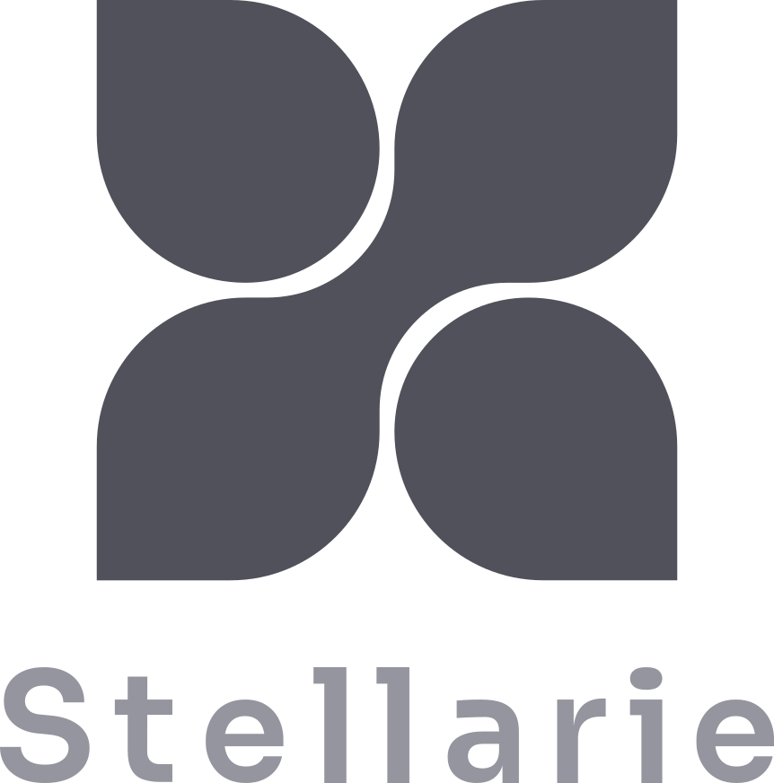

<div align="center">
  
  <p><strong>A local-first personal time intelligence desktop application.</strong></p>
  <p>
    <a href="#about">About</a> ·
    <a href="#what-it-does">What it does</a> ·
    <a href="#privacy">Privacy</a> ·
    <a href="#project-status">Project status</a> ·
    <a href="docs/index.html">Website</a>
  </p>
</div>

---

## About

STELLAREI was an experiment in making personal time easier to understand.

It observes activity on a person's own computer, turns that activity into useful timelines and summaries, and provides tools to reflect on how time is spent. The application was designed around a local-first approach: personal activity data stays on the device, without an account, a hosted backend, or product telemetry.

This repository preserves the original STELLAREI implementation as an open-source project and development record.

## What it does

The desktop application brings together several areas of personal time management:

- **Activity tracking and timelines** — records foreground application activity and organizes it into sessions.
- **Analytics and insights** — explores time by category and project, with trends and context-switching views.
- **Projects, categories, goals and budgets** — gives activity a structure and helps compare time against personal intentions.
- **Focus, timers and alarms** — supports focused work sessions, Pomodoro-style timers and reminders.
- **Calendar and time receipts** — makes daily and longer-term activity easier to review.
- **Patterns and digital-waste insights** — surfaces evidence-based patterns without assigning moral value to how someone spends time.
- **Privacy controls** — provides exclusions, retention controls and optional screenshot memory.
- **Backups and exports** — supports keeping a copy of personal data.
- **Themes and languages** — includes theme customization and English, Persian and German interface resources.
- **Optional local AI** — can connect to compatible local or self-hosted AI services. AI features are optional and scope-controlled.

The exact availability and maturity of individual features reflect this archived codebase. The list describes the project's implemented direction, not a promise of ongoing support.

## Privacy

Privacy was a core design constraint, not an add-on.

- Data is stored locally in SQLite.
- The application does not require an account or a cloud service.
- Product telemetry is not part of the application.
- Screenshots and browser-related tracking are opt-in rather than enabled by default.
- The activity model is based on application and window context, not keystroke recording.

Review the source code and your own configuration before using any activity-monitoring software on a device.

## Technology

- Go
- Wails v3
- React and TypeScript
- Vite
- SQLite
- CSS theme tokens

## Project status

**STELLAREI is no longer under active development.**

STELLAREI and Weloury were brought together into a larger commercial application. The combined product is the successor to both projects, and their functionality is being rewritten in Rust as part of that application.

That means this repository is now a historical, standalone release of STELLAREI. It will not receive feature development or ongoing maintenance. The successor is a separate product; this repository remains available so the original work can be explored and preserved.

## Building from source

This repository contains the original Go/Wails and React/TypeScript application. The build toolchain and platform dependencies are version-sensitive, so consult [`PACKAGING.md`](PACKAGING.md) before attempting a build.

At a high level, you will need:

- Go version compatible with the `go.mod` directive
- Node.js and npm
- The Wails v3 CLI version used by this project
- Platform-specific Wails build dependencies

Install frontend dependencies:

```bash
cd frontend
npm ci
cd ..
```

Then follow the platform-specific instructions in [`PACKAGING.md`](PACKAGING.md).

## Repository

The application source is organized around:

- `app/services/` — services exposed to the desktop frontend
- `internal/` — activity, session, privacy, analytics and other application logic
- `frontend/` — React interface, translations, themes and generated Wails bindings
- `migrations/` — SQLite schema migrations
- `assets/` and `build/` — application and platform assets
- `scripts/` — project maintenance and asset-generation utilities

## License

STELLAREI is released under the MIT License. See [`LICENSE`](LICENSE).

The MIT license applies to the project code and repository materials that the project has the right to license. Third-party dependencies and bundled third-party components remain subject to their own licenses.
